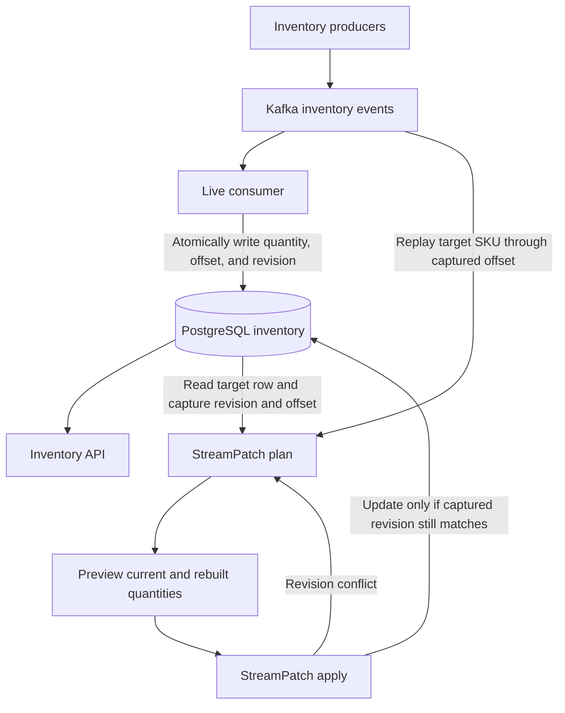
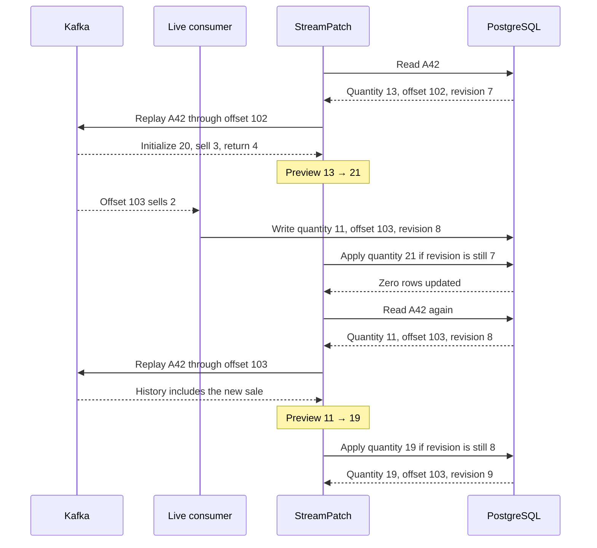

# StreamPatch

StreamPatch is a planned C++ tool for repairing incorrect PostgreSQL state derived from Kafka events while the live consumer keeps processing updates.

An inventory service might process every event successfully and still serve the wrong quantity because of a bug in its update logic. After deploying the fix to the live consumer, an operator can use StreamPatch to rebuild an affected SKU from Kafka, preview the correction, and apply it without overwriting newer inventory updates.

## Data flow

The live consumer and the repair path share the same inventory table. Each live update advances the row revision. A repair changes the quantity and advances the revision while preserving the last applied Kafka offset. The revision check and update run in one SQL statement. The live consumer also guards writes based on a previously read row so it cannot overwrite a repair with a stale calculation.

## Worked example

A bug subtracts returns from inventory. For SKU `A42`, the events below leave PostgreSQL showing **13 units**. The corrected replay calculates **21**.

| Kafka offset | Event | Stored quantity with bug | Correct quantity |
| --- | --- | ---: | ---: |
| 100 | Initialize with 20 units | 20 | 20 |
| 101 | Sell 3 units | 17 | 17 |
| 102 | Return 4 units | 13 | 21 |
| 103 | Sell 2 units after the fix is deployed | 11 | 19 |

Walk through a repair that races with a live sale

The stale plan leaves the row untouched. The next plan includes the new sale, and a full replay through offset 103 independently verifies the final quantity of 19.

## Roadmap

| Milestone | Scope | How to verify it |
| --- | --- | --- |
| **1. Repair one SKU** | One Kafka partition and one sequential consumer. A C++ CLI exposes `plan` and `apply`, with a revision check on every repair. | Repair seeded inventory while consumption continues. Force a concurrent write and verify that the stale plan is rejected. Compare the repaired row with a full replay at the same offset. |
| **2. Repair across partitions** | Plan repairs for multiple SKUs using per-key replay bounds and bounded concurrency. Record a result for each key so interrupted jobs can resume. | Interrupt a batch, resume it, and verify the final quantities and offsets against replay. |
| **3. Handle incomplete history** | Track where replay can safely begin. Support trusted snapshots plus retained events, and block a repair when the required history is missing. | Test with expired Kafka history and show that only keys with sufficient history can be repaired. |
| **4. Operate under load** | Add a durable audit trail, repair rate limits, and metrics for consumer lag, replay duration, and revision conflicts. | Run the same live workload with and without a repair batch and report the change in lag and processing latency. |

This repository currently documents the design and roadmap.
